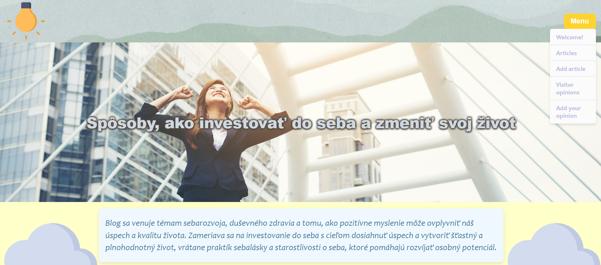

# 🌐 Applications of web technologies

* **Course Topic:** Internet architecture, web technologies, client-side web development, and data formats.
* **Core Technologies:** HTML5, CSS3, JavaScript (DOM, AJAX), XML, and HTTP protocol.
* **Key Topics:** Web application architecture, dynamic web pages, markup validation, and client-side scripting.
* **Goal:** Master front-end development principles and build interactive web applications.

## 📸 Screenshots

### Main Page

